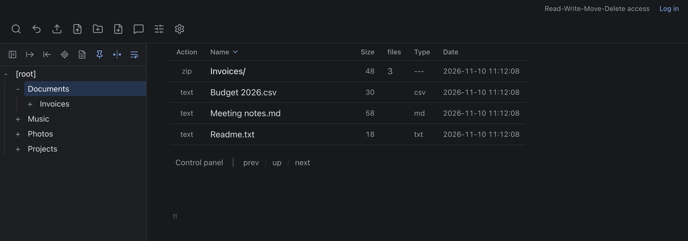
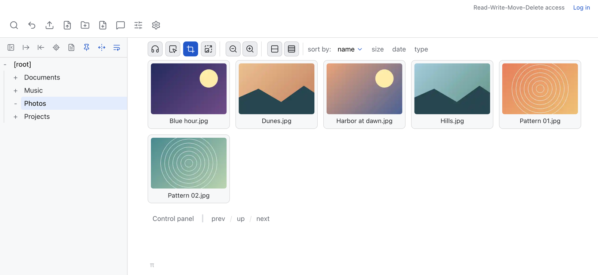

# copyparty: the boring mode

A fork of [copyparty](https://github.com/9001/copyparty) with a plain interface. Only the interface is changed. The server behaves as before.





## Changes

- New theme "plain", dark and light, with [Lucide](https://lucide.dev) icons instead of emoji. Plain dark is the default. The upstream themes are still there.
- English texts rewritten: labels, tooltips, error pages. `dsel` is "Drag select". `403 forbiddena ~┻━┻` is `403 forbidden`.
- Tabs in the settings panel and the media player panel.
- Neutral placeholders in the grid view.
- Removed: the "fuzzy" file size format.
- Minor bug fixes.

Not changed: URLs, API, config format, upload protocol, and the other 22 languages.

## Run

```
git clone https://github.com/alexbartok/copyparty
cd copyparty
python3 -m copyparty
```

This needs Python 3 and Jinja2 (`pip install jinja2`).

The default theme is plain dark. `--theme 11` sets plain light, `--theme 0` the upstream default.

A source checkout has no `copyparty/web/deps` (markdown editors, fonts). Build it with `scripts/deps-docker`, or copy it from an upstream install.

## Upstream

Based on copyparty v1.20.26. I merge upstream by hand, so this fork can be behind. The upstream documentation is in [README-upstream.md](README-upstream.md).

## Credit

copyparty: ed ([9001](https://github.com/9001)) and contributors, MIT license. Icons: Lucide, ISC license ([docs/boring/LUCIDE-LICENSE](docs/boring/LUCIDE-LICENSE)). Changes made with Claude Code.
